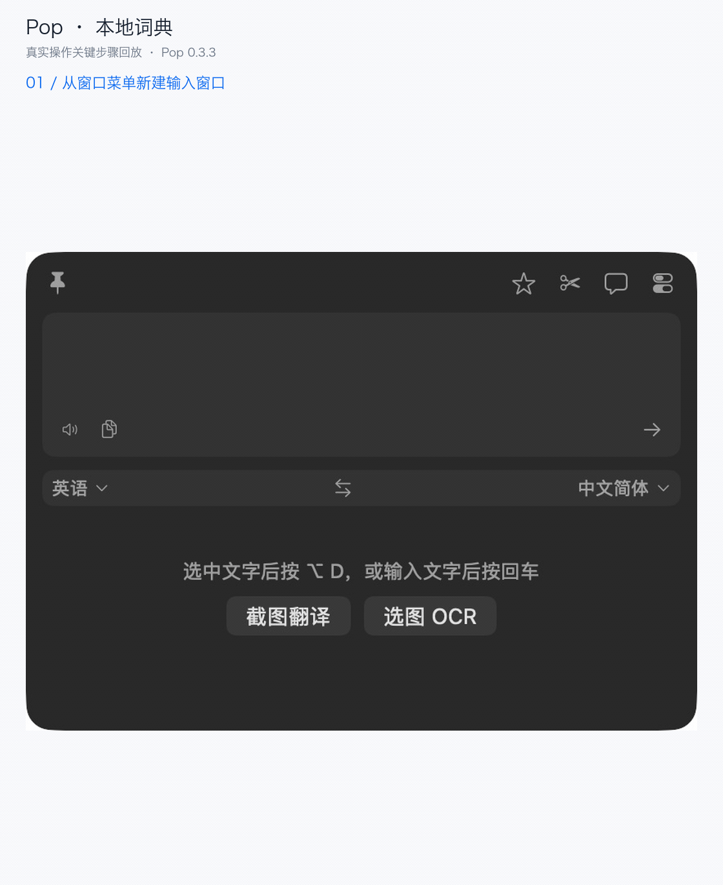
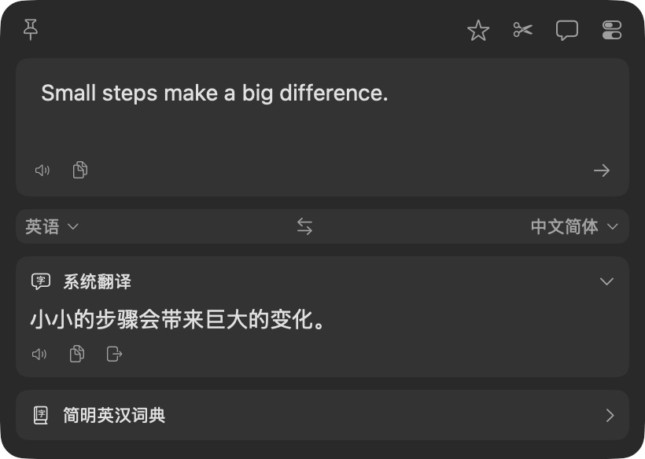
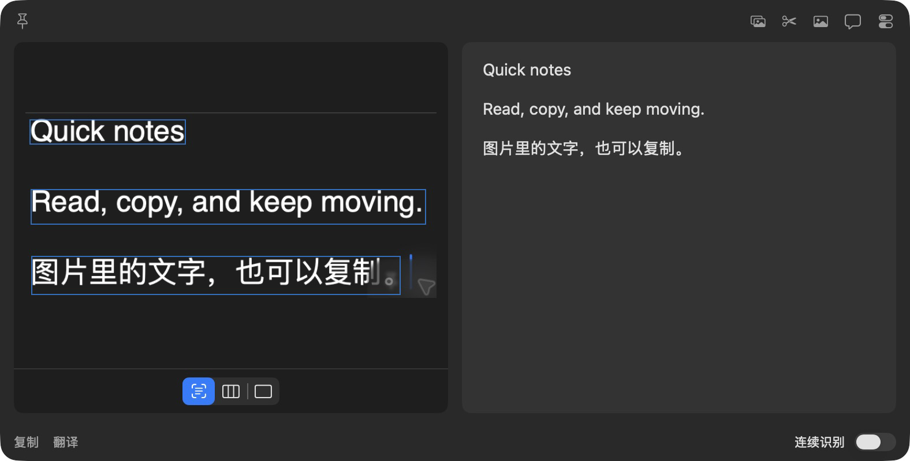
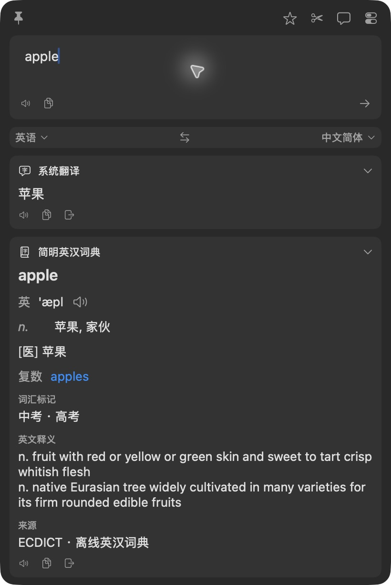

# Pop · macOS 划词翻译与截图 OCR

在不同应用中快速取词、翻译和识别图片文字，支持本地词典及自定义 AI 服务。



**[⬇ 下载 Pop for macOS · DMG](https://yemin11238.github.io/Pop/download.html?format=dmg)**　[ZIP 下载](https://yemin11238.github.io/Pop/download.html?format=zip) · [最新 Release](https://github.com/YEMIN11238/Pop/releases/latest) · [产品介绍](https://yemin11238.github.io/Pop/)

**macOS 15+ · Apple Silicon / Intel 通用安装包 · 无需编译**

首次打开可能需要系统确认（当前未公证）。[安装与权限说明](docs/first-use.md)

## 三个常用场景

### 阅读外文：选中词句，按 ⌥D

在其他应用中选中词句，按 `⌥D` 查看翻译，然后复制结果。支持的可编辑输入框还可使用回填按钮；取词与回填需要辅助功能权限。



本次实测在 TextEdit 中选中 `Small steps make a big difference.`，由用户按下 `⌥D`。Pop 正确取得原文，系统翻译返回“小小的步骤会带来巨大的变化。”；点击复制后，在 TextEdit 粘贴的内容一致。

### 提取图片文字：截图或选图 OCR

在 OCR 窗口点击「截图 OCR」，拖动框选包含文字的区域，检查、编辑并复制识别结果。默认使用本机 Apple Vision，无需个人云 API Key；屏幕框选需要录屏权限。也可以从菜单栏选择「选图 OCR…」读取本地图片。



本次通过「截图 OCR」按钮进入真实屏幕框选，识别 TextEdit 中的中英测试文字，复制后粘贴内容一致。截图 OCR 的默认快捷键为 `⌥⇧S`；本轮未验证该组合键的实际按键触发。

### 查单词：按 ⌥A，输入 apple

输入单词后按回车，在「简明英汉词典」卡片查看释义并复制。词典数据随安装包提供，查词不需要联网、API Key、录屏或辅助功能权限；它用于单词和词组，不承担整句翻译。



本地词典场景使用「窗口 → 新翻译窗口」进入，查询与复制粘贴已实测。默认 `⌥A` 可打开输入窗口；本轮未验证该组合键的实际按键触发。顶部动图组合了三个场景的真实操作关键步骤，是逐步截取的画面回放，并非连续录屏。参见 [演示环境与验证范围](docs/demo-notes.md)。

## 下载安装与第一次使用

1. 下载 [DMG](https://yemin11238.github.io/Pop/download.html?format=dmg)，打开后将 **Pop.app 拖入 Applications（应用程序）**。也可下载 ZIP，解压后将 Pop.app 移入应用程序。
2. 从「应用程序」打开 Pop。启动显示设置页，关闭设置后仍可通过菜单栏或快捷键使用。
3. 按 `⌥A`，输入 `apple` 并按回车。点击「简明英汉词典」结果下方的复制按钮，再粘贴到文本编辑中，即完成第一次查词。
4. 需要划词时再开辅助功能权限，需要屏幕截图时再开录屏权限。**暂不授权，仍可手动输入、粘贴文字、查本地词典及选择图片 OCR。**

> **首次打开受系统拦截？** 当前发布包没有 Apple Developer ID 签名或公证。先尝试打开一次，再到「系统设置 → 隐私与安全性」找到 Pop 并选择「仍要打开」。无需关闭系统安全保护。详细步骤、授权位置和更新方法见 **[首次使用教程](docs/first-use.md)**。

## 无需配置即可使用 / 需要自行配置

| 能力 | 开始前需要做什么 | 本地与联网边界 |
| --- | --- | --- |
| **Apple 系统翻译** | 默认启用，无需 API Key；首次使用某个语言对时按系统提示下载语言包 | 使用 macOS 翻译框架；语言包准备需要联网，不承诺首次启动即可离线或支持所有语言 |
| **Apple Vision OCR** | 默认启用；选图即用，截取屏幕需录屏权限 | 本机识别，不向云 OCR 服务发送图片 |
| **简明英汉词典（ECDICT）** | 默认启用，词库随包提供 | 本地查询，不需要联网；覆盖词库已有单词和词组 |
| **自定义云 API** | 自行开通服务，填写地址、模型、密钥等字段并启用 | 查询发送到所选服务；费用、额度和模型由服务商决定 |
| **本地模型（Ollama / LM Studio）** | 自行安装、下载并运行模型，在 Pop 中填写服务地址和模型名 | 使用本机端点时请求留在本机；模型下载需要网络，若填写远程地址则发送到该地址 |

无需 Pop 账户或购买 Pop 许可证。系统翻译、词典和 OCR 是不同服务，不能把它们统称为“完全离线翻译”。新增云服务不会替你提供账户或 API Key。

### macOS 15 与 macOS 26 的差别

| 使用方式 | macOS 15 | macOS 26 及以上 |
| --- | --- | --- |
| 手动输入、划词、截图后在普通窗口翻译 | 支持；Apple 系统翻译需支持该语言对并准备语言包 | 支持，同样受语言支持与语言包状态限制 |
| Vision OCR、本地词典 | 支持 | 支持 |
| Apple 系统服务的静默翻译、原图翻译浮层 | 当前实现不支持；可改用已配置的其他翻译服务 | 支持；先在普通翻译窗口下载对应语言包 |
| 云 API / 本地模型 | 需自行配置和验证对应服务 | 需自行配置和验证对应服务 |

普通「截图翻译」会把识别出的文字放入翻译窗口，与直接在截图上覆盖译文的「原图翻译」不同。上表的 macOS 26 限制针对 Apple 系统服务的后台调用，不是所有截图或 OCR 功能都要求 macOS 26。Windows、Linux 和 macOS 14 及更早版本不支持。

## 更多功能与配置

- **日常使用**：可修改快捷键、历史与收藏、系统朗读、文本预处理、多服务结果、Markdown / 公式 / 图表显示。
- **OCR**：剪贴板图片、静默识别、多图队列、二维码及识别文本合并。
- **服务**：OpenAI 兼容接口、DeepSeek、Gemini、Claude、Ollama 等；可配置 URL、模型、密钥与提示词。Gemini、Claude、Ollama 有各自原生协议，不能把所有地址混填到同一种协议中。见 [云服务说明](CLOUD_SERVICES.txt)。
- **扩展**：部分 `.bobplugin` API、URL / AppleScript，以及 PopClip / Raycast / Alfred 集成包。见 [集成说明](Integrations/README.txt)。第三方插件与服务需要自行配置，兼容范围受当前实现限制。

默认快捷键：`⌥D` 划词翻译，`⌥S` 截图翻译，`⌥A` 输入翻译，`⌥⇧S` 截图 OCR，`⌥C` 静默截图 OCR。其他操作可从菜单栏调用，或在设置中分配快捷键。若与其他应用冲突，请在「翻译设置」或「OCR 设置」修改。

**更新**：退出正在运行的 Pop，下载最新 DMG / ZIP，用新 Pop.app 替换「应用程序」中的旧版本，再重新打开。保留原来的本机设置；不要同时运行安装包、下载目录与应用程序中的多个副本。若更新后权限失效，按 [更新与权限排查](docs/first-use.md#更新-pop) 处理。Release 提供 `SHA256SUMS.txt`，可用 `shasum -a 256 文件名` 核对。

## 项目范围

Pop 是受 Bob 使用方式启发的独立实现，与 Bob 及其开发者无隶属关系。本仓库不包含 Bob 的二进制、反编译输出、词库或提取的界面图片；公开版本使用 macOS 系统符号和本地绘制的服务标记，不打包提取的厂商或 Bob 图标。

**目前不承诺与 Bob 完全相同。** Bob 账户、托管云额度与服务端内容不包含在内；词典数据、部分图标与文案不同；部分 OCR / TTS 提供商、插件 API、复杂排版、跨软件回填与多屏行为仍需继续验证。不能导入完整 Bob 私有配置或历史。

## 数据与隐私

- 设置和默认开启的翻译历史保存在本机 `~/Library/Application Support/Pop/`。可在设置里关闭保存历史。
- API Key 保存在 macOS 钥匙串。仅启用的服务会收到对应查询；云 OCR 会发送你选择的图片，远程图片加载默认关闭。
- 插件会执行 JavaScript 并可能发起网络请求。独立插件进程并非 macOS 安全沙盒，只安装可信插件。
- 仓库与安装包不包含开发者的个人设置、历史或凭据。应用没有自动上传诊断的端点。

## 从源码构建

普通下载用户不需要这些工具。开发者需要 **Xcode 26+ / macOS SDK 26+、Swift 6 工具链**；程序的部署目标仍为 macOS 15。部分 macOS 26 API 有运行版本保护。

```sh
git clone https://github.com/YEMIN11238/Pop.git
cd Pop
bash Scripts/build.sh --output "$PWD/dist.noindex" --scratch-path "$PWD/.build-release.noindex"
```

打包脚本用法见 `bash Scripts/package-release.sh --help`。测试：

```sh
swift test --scratch-path .build-tests.noindex
# 对已构建的包做集成自检：会启动临时本地测试端点，检查系统语言服务。
dist.noindex/Pop.app/Contents/MacOS/Pop --self-check
```

数据库已随源码和安装包提供，不需要在首次使用时下载。重新生成请参考 `Scripts/build-dictionary.py --help`；[固定上游数据与哈希](Resources/Dictionaries/ECDICT-provenance.json) 随包保存。

## 许可证与反馈

项目代码使用 [MIT License](LICENSE)。第三方代码、词典和字体保留各自许可证，见 [第三方材料说明](THIRD_PARTY_NOTICES.txt) 与 `Licenses/`。应用图标由项目发起人提供。服务商名称只用于说明可连接的接口。

问题请提交到 [Issues](https://github.com/YEMIN11238/Pop/issues)，附 macOS 版本、芯片类型、Pop 版本和复现步骤；不要提交密钥、完整个人配置或敏感原文。发布包的验证范围会写在每版 Release 说明中。
